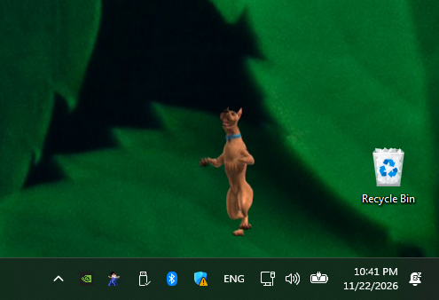
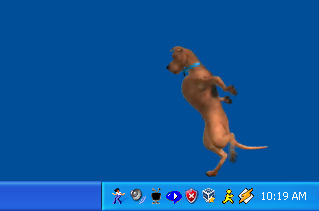
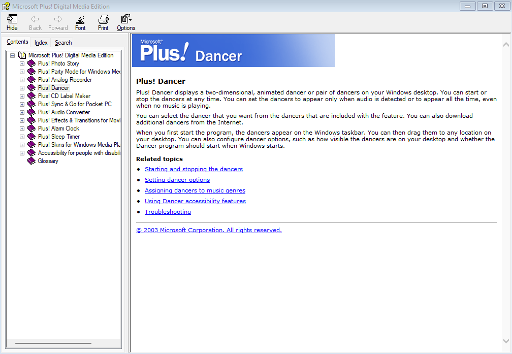
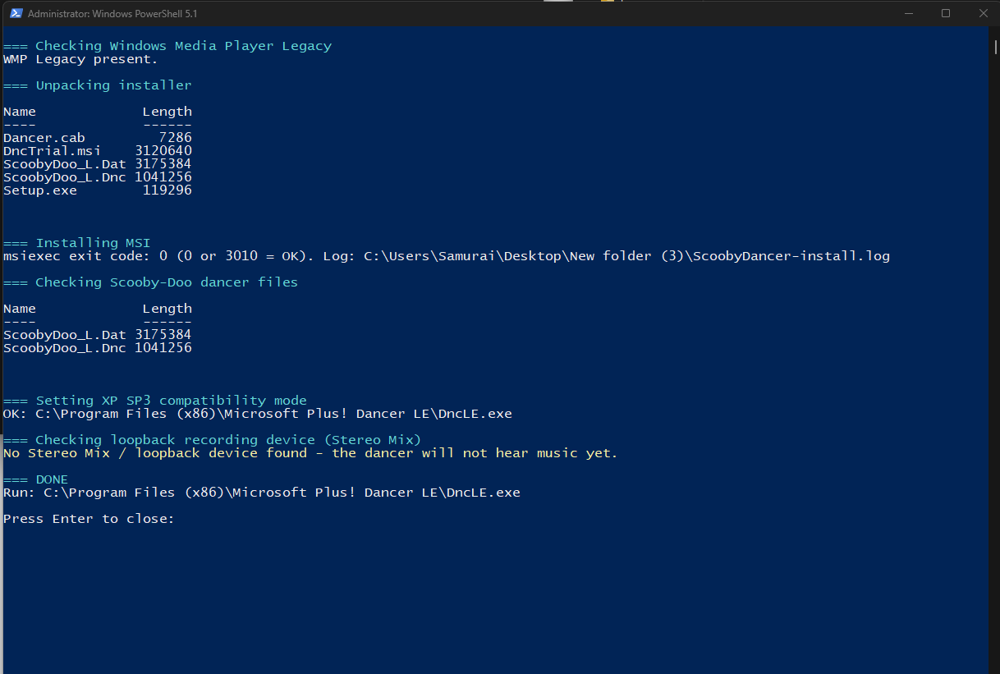

# Scooby-Doo Dancer (Microsoft Plus! Dancer LE) on Windows 10/11

Installs the 2004 Microsoft Plus! Dancer LE with the Scooby-Doo dancer on modern Windows.
Tested: Windows 11 — installs, runs, dances to system audio. Minor visual glitches.

## Original on Windows XP

## Install
1. Clone/download the repo.
2. Run `Install-ScoobyDancer.cmd` (asks for admin).
3. Start `C:\Program Files (x86)\Microsoft Plus! Dancer LE\DncLE.exe`.

## Install output

## What the script does
- Ensures Windows Media Player Legacy is present (DncLE.exe hosts the WMP control).
- Finds the installer by content (script folder or Downloads), unpacks it with wextract `/Q /C /T:`.
- Creates empty `Content\` and `Partner.reg` stubs — the MSI's deferred `InstallPartnerContents` custom action has no ignore-error flag.
- Installs `DncTrial.msi` silently (`LAUNCHPROGRAM=0`), log next to the script.
- Copies `ScoobyDoo_L.Dnc/.Dat` into `...\Microsoft Plus! Digital Media Edition\Dancer\Dancers\Downloaded` if missing.
- Sets `~ WINXPSP3` compatibility layer for `DncLE.exe` (HKLM).
- Reports loopback recording devices (the dancer listens via waveIn). Detection is name-based and may miss vendor-named devices.

## Installer contents
`Scooby_DancerLE.exe` — IExpress SFX → `DncTrial.msi` (InstallShield 7.02, Plus! Dancer LE 1.1.0.3464, bundles VC++ 7.0 runtimes), `ScoobyDoo_L.Dnc`, `ScoobyDoo_L.Dat`, `Dancer.cab`, `Setup.exe`.

Installer binary © Microsoft / Warner Bros. Personal archive.
